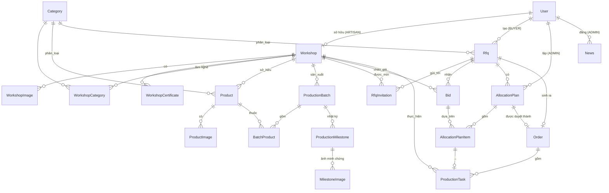

# 03 — Thiết kế cơ sở dữ liệu (Database)

**DBMS:** PostgreSQL. **ORM:** Prisma. Mọi thay đổi schema đi qua `prisma migrate dev` (khi dev) và `prisma migrate deploy` (khi chạy demo). **Không** dùng `prisma db push` trên CSDL chung của nhóm.

**Quy ước** *(theo DBML của nhóm)*:
- Tên bảng = tên model Prisma, viết `PascalCase` số ít (`ProductionBatch`). Tên cột = tên field, viết `camelCase` (`workshopId`). Không dùng `@@map`.
- Khóa chính của mọi bảng: `String @id @default(uuid()) @db.Uuid`.
- Thời gian: `DateTime`. Prisma ánh xạ sang `timestamp(3)` trong PostgreSQL và lưu theo UTC; frontend đổi sang giờ Việt Nam khi hiển thị. `createdAt` dùng `@default(now())`, `updatedAt` dùng `@updatedAt`.
- Trạng thái: **mọi cột trạng thái đều là enum Prisma** (danh sách ở mục 2). CSDL tự chặn giá trị không hợp lệ.
- Tiền: **`Decimal @db.Decimal(12,2)` cho toàn bộ schema**. Prisma trả về đối tượng `Decimal`, nên khi trả JSON phải chuyển sang `string` hoặc `number`. Khi tính toán dùng `.mul()`, `.add()`, không dùng phép tính số thực của JavaScript.
- Ràng buộc mà Prisma schema không khai báo được (CHECK, partial unique index) thì thêm bằng **SQL trong file migration**: tạo migration với `prisma migrate dev --create-only`, sửa file SQL, rồi mới apply.
- Vì tên bảng và cột có chữ hoa, **SQL viết tay phải đặt tên trong dấu nháy kép**, ví dụ `"ProductionBatch"."workshopId"`. Riêng bảng `"Order"` là từ khóa SQL nên lúc nào cũng phải có nháy.

**Phân công schema:** tài khoản, RFQ và đơn hàng do N1 phụ trách (N1-T1-04). Xưởng, sản phẩm, lô, nhật ký và nhiệm vụ do N2 phụ trách (N2-T1-01, N2-T3-08). Lời mời, báo giá, phương án và tin tức do N3 phụ trách (N3-T1-02).

---

## 1. Sơ đồ ERD



Bảng `session` do session store quản lý nên không vẽ vào sơ đồ.

## 2. Enum

| Enum | Giá trị | Ghi chú |
|------|---------|---------|
| `UserRole` | `ADMIN`, `ARTISAN`, `BUYER` | |
| `UserStatus` | Do N1 chốt | Dùng cho `User.status` |
| `WorkshopStatus` | `PENDING`, `APPROVED`, `REJECTED` | Trạng thái duyệt xưởng; mặc định `PENDING` |
| `ProductStatus` | `VISIBLE`, `HIDDEN` | Mặc định `HIDDEN` |
| `BatchStatus` | `PLANNED`, `IN_PROGRESS`, `COMPLETED`, `CANCELLED` | Mặc định `PLANNED` |
| `RfqStatus` | `DRAFT`, `SENT`, `BIDDING`, `ACCEPTED`, `IN_PRODUCTION`, `DELIVERED` | Đúng luồng của đề |
| `InvitationStatus` | `INVITED`, `VIEWED`, `BID_SUBMITTED` | |
| `BidStatus` | `SUBMITTED`, `ACCEPTED`, `REJECTED` | Khi phương án được duyệt, bid nằm trong phương án chuyển `ACCEPTED`, các bid còn lại chuyển `REJECTED` |
| `PlanStatus` | `DRAFT`, `PENDING_BUYER`, `ACCEPTED`, `REJECTED` | |
| `OrderStatus` | `IN_PRODUCTION`, `READY`, `DELIVERED` | `READY` = mọi nhiệm vụ đã hoàn thành, đang chờ Buyer xác nhận |
| `TaskStatus` | `ASSIGNED`, `IN_PROGRESS`, `COMPLETED` | `COMPLETED` = xưởng đã hoàn thành và bàn giao |
| `NewsCategory` | `MATERIAL_PRICE`, `POWER_OUTAGE`, `SUPPORT_POLICY` | Đúng 3 nhóm |
| `NewsStatus` | `DRAFT`, `PUBLISHED` | |

> Quy tắc đồng bộ trạng thái RFQ, phương án, đơn và nhiệm vụ được chốt ở `04-quotation-flow.md` (N3-T1-01, N2-T3-08).

## 3. Lưu ảnh

Không dùng bảng media riêng. Ba bảng ảnh `WorkshopImage`, `ProductImage` và `MilestoneImage` tự lưu đường dẫn theo cùng một mẫu (`WorkshopCertificate` dùng một cột `fileUrl` riêng). **Chỉ nhận file ảnh** (kể cả chứng nhận), và mọi ảnh đều đi qua cùng một pipeline Sharp:

| Cột | Ý nghĩa |
|-----|---------|
| `imageUrl` | Bản đã resize để hiển thị (không phải ảnh gốc) |
| `thumbUrl` | Thumbnail cho grid, danh sách, popup. **NOT NULL**, vì Sharp luôn sinh thumbnail |
| `altText` | Mô tả ảnh (accessibility) |
| `sortOrder` | Thứ tự hiển thị |

- Lưu **đường dẫn tương đối** (`/uploads/...`), không lưu URL tuyệt đối, để đổi máy demo hay đổi `APP_PUBLIC_URL` không làm hỏng ảnh.
- Xóa bản ghi bằng `cascade` **không** xóa file trên đĩa. Service phải lấy danh sách đường dẫn **trước khi xóa**, rồi xóa file sau khi transaction thành công (N2-T2-03, N2-T5-02).
- Ảnh QR **không lưu**: server sinh QR mỗi lần được yêu cầu, từ `APP_PUBLIC_URL/truy-xuat/:batchCode`.

## 4. Chi tiết các bảng

### 4.1. Tài khoản và phiên (N1)

**`User`**

| Cột | Kiểu | Ràng buộc / Ghi chú |
|-----|------|---------------------|
| id | uuid | PK |
| email | varchar(255) | UNIQUE, NOT NULL, lưu dạng lowercase |
| passwordHash | varchar(255) | NOT NULL (bcrypt) |
| fullName | varchar(150) | NOT NULL |
| phone | varchar(20) | Dùng để tự điền vào form RFQ |
| role | UserRole | NOT NULL |
| status | UserStatus | NOT NULL; giá trị cụ thể do N1 chốt |
| createdAt, updatedAt | timestamp | |

DBML của N2 chỉ khai báo `User` ở mức tối giản (`id, email, role, status`). Schema thực tế do N1 quản lý. Artisan "chờ duyệt" được thể hiện bằng `Workshop.status`.

**`session`**: dùng cho session store PostgreSQL.

| Cột | Kiểu | Ghi chú |
|-----|------|---------|
| sid | varchar | PK |
| sess | json | Dữ liệu phiên (`userId`, `role`) |
| expire | timestamp(6) | Có index |

> Đây là **ngoại lệ** của quy ước đặt tên: tên bảng và cột phải đúng như session store yêu cầu (`connect-pg-simple` mặc định dùng bảng `session`). Khai báo bảng này trong `schema.prisma`, dùng `@@map("session")` cho model `Session`. Nếu để store tự tạo bảng, Prisma sẽ phát hiện drift và đòi reset CSDL.

### 4.2. Xưởng (N2)

**`Workshop`**

| Cột | Kiểu | Ràng buộc / Ghi chú |
|-----|------|---------------------|
| id | uuid | PK |
| ownerId | uuid | FK → User (**restrict**), NOT NULL, **UNIQUE**: mỗi Artisan sở hữu đúng 1 xưởng |
| name | varchar(255) | NOT NULL |
| slug | varchar(255) | **UNIQUE**, NOT NULL, dùng cho `/xuong/:slug` |
| description | text | Giới thiệu ngắn (card, popup bản đồ) |
| history | text | Lịch sử gia đình, câu chuyện làm nghề |
| address | text | NOT NULL |
| latitude | decimal(9,6) | NULL cho tới khi chọn trên bản đồ |
| longitude | decimal(9,6) | |
| isOpenForVisit | boolean | NOT NULL, DEFAULT false: quyết định màu pin |
| openingHours | jsonb | Ví dụ `{"mon":[["08:00","17:00"]],"sun":[]}` |
| acceptsOrders | boolean | NOT NULL, DEFAULT true: xưởng có nhận RFQ không (dùng khi matching) |
| status | WorkshopStatus | NOT NULL, DEFAULT `PENDING` |
| rejectionReason | text | Lý do Admin từ chối (N3-T1-06) |
| reviewedById | uuid | FK → User (Admin), NULL |
| reviewedAt | timestamp | Thời điểm duyệt hoặc từ chối |
| createdAt, updatedAt | timestamp | NOT NULL |

Index: `(status)`; `ownerId` đã có index nhờ UNIQUE. Ảnh đại diện của xưởng là `WorkshopImage` có `sortOrder` nhỏ nhất.

**`WorkshopCategory`**: bảng trung gian N-N giữa xưởng và danh mục, dùng cho matching RFQ.

| Cột | Kiểu | Ràng buộc / Ghi chú |
|-----|------|---------------------|
| workshopId | uuid | PK ghép, FK → Workshop (**cascade**) |
| categoryId | uuid | PK ghép, FK → Category (**restrict**) |

Index: `(categoryId)`, phục vụ truy vấn "những xưởng nào làm danh mục X". Artisan chọn danh mục trong form hồ sơ xưởng. Khi tạo sản phẩm, `Product.categoryId` phải nằm trong danh sách danh mục của xưởng (kiểm tra ở service).

**`WorkshopImage`**

| Cột | Kiểu | Ràng buộc / Ghi chú |
|-----|------|---------------------|
| id | uuid | PK |
| workshopId | uuid | FK → Workshop (**cascade**), NOT NULL |
| imageUrl | text | NOT NULL |
| thumbUrl | text | NOT NULL |
| altText | text | |
| sortOrder | int | NOT NULL, DEFAULT 0 |
| createdAt | timestamp | NOT NULL |

Index: `(workshopId, sortOrder)`.

**`WorkshopCertificate`**

| Cột | Kiểu | Ràng buộc / Ghi chú |
|-----|------|---------------------|
| id | uuid | PK |
| workshopId | uuid | FK → Workshop (**cascade**), NOT NULL |
| title | varchar(255) | NOT NULL (ví dụ "Nghệ nhân ưu tú", "OCOP 4 sao") |
| issuer | varchar(255) | NOT NULL |
| issuedAt | date | NULL nếu không có ngày cấp |
| fileUrl | text | NOT NULL: **ảnh** chứng nhận (không nhận PDF) |
| createdAt | timestamp | NOT NULL |

Index: `(workshopId)`.

### 4.3. Danh mục và sản phẩm (N2)

**`Category`**

| Cột | Kiểu | Ràng buộc / Ghi chú |
|-----|------|---------------------|
| id | uuid | PK |
| name | varchar(255) | NOT NULL |
| slug | varchar(255) | **UNIQUE**, NOT NULL |

**`Product`**

| Cột | Kiểu | Ràng buộc / Ghi chú |
|-----|------|---------------------|
| id | uuid | PK |
| workshopId | uuid | FK → Workshop (**restrict**), NOT NULL |
| categoryId | uuid | FK → Category (**restrict**), NOT NULL |
| name | varchar(255) | NOT NULL |
| slug | varchar(255) | **UNIQUE** toàn hệ thống, NOT NULL, dùng cho `/san-pham/:slug` |
| description | text | |
| specifications | jsonb | Thông số linh hoạt, ví dụ `{"chatLieu":"Đất sét trắng","kichThuoc":"Cao 35cm"}` |
| price | decimal(12,2) | NULL = "Liên hệ báo giá"; CHECK `price >= 0` nếu có giá trị |
| status | ProductStatus | NOT NULL, DEFAULT `HIDDEN` |
| createdAt, updatedAt | timestamp | NOT NULL |

Index: `(workshopId, categoryId, status)`, `(categoryId, status)`.

**`ProductImage`**

| Cột | Kiểu | Ràng buộc / Ghi chú |
|-----|------|---------------------|
| id | uuid | PK |
| productId | uuid | FK → Product (**cascade**), NOT NULL |
| imageUrl | text | NOT NULL |
| thumbUrl | text | NOT NULL |
| altText | text | |
| sortOrder | int | NOT NULL, DEFAULT 0 |
| isPrimary | boolean | NOT NULL, DEFAULT false: ảnh đại diện trên grid catalog |
| createdAt | timestamp | NOT NULL |

Index: `(productId, sortOrder)`.

**SQL bổ sung trong migration:**
```sql
-- Mỗi Product có tối đa 1 ảnh đại diện
CREATE UNIQUE INDEX "ProductImage_one_primary_per_product"
  ON "ProductImage" ("productId")
  WHERE "isPrimary" = true;

ALTER TABLE "Product"
  ADD CONSTRAINT "Product_price_nonneg" CHECK ("price" IS NULL OR "price" >= 0);
```

> Đổi ảnh đại diện phải chạy trong transaction theo thứ tự: bỏ `isPrimary` của ảnh cũ trước, rồi mới đặt cho ảnh mới. Làm ngược lại sẽ vi phạm partial unique index.

> **Xóa sản phẩm:** vì `BatchProduct.productId` dùng `restrict`, sản phẩm đã nằm trong một lô thì **không xóa được**. Như vậy QR đã in không bị gãy. Muốn gỡ sản phẩm thì chuyển sang `HIDDEN`. API xóa phải bắt lỗi khóa ngoại (Prisma `P2003`) và trả 409 kèm thông báo rõ ràng (N2-T5-01).

### 4.4. Lô sản xuất và nhật ký (N2)

**`ProductionBatch`**: mỗi lô có **một QR** (TECH-01, TECH-02).

| Cột | Kiểu | Ràng buộc / Ghi chú |
|-----|------|---------------------|
| id | uuid | PK |
| workshopId | uuid | FK → Workshop (**restrict**), NOT NULL |
| batchCode | varchar(100) | **UNIQUE**, NOT NULL: chính là `maLo` trong `/truy-xuat/:batchCode` |
| name | varchar(255) | NOT NULL |
| description | text | Câu chuyện chung của lô |
| status | BatchStatus | NOT NULL, DEFAULT `PLANNED` |
| isPublic | boolean | NOT NULL, DEFAULT false. Khi chưa công khai, API truy xuất trả 404 |
| startedAt | timestamp | Service tự đặt khi lô chuyển sang `IN_PROGRESS` |
| completedAt | timestamp | Service tự đặt khi lô chuyển sang `COMPLETED` |
| createdAt, updatedAt | timestamp | NOT NULL |

Index: `(workshopId)`, `(workshopId, status)`.

> Lô `CANCELLED` mà vẫn `isPublic = true` thì trang truy xuất **vẫn hiển thị**, kèm nhãn **"Đã hủy"**, để QR đã in không trả về trang lỗi.

**`BatchProduct`**: bảng trung gian N-N giữa lô và sản phẩm.

| Cột | Kiểu | Ràng buộc / Ghi chú |
|-----|------|---------------------|
| batchId | uuid | PK ghép, FK → ProductionBatch (**cascade**) |
| productId | uuid | PK ghép, FK → Product (**restrict**) |
| quantity | int | NOT NULL, CHECK `> 0` |

Index: `(productId)`, dùng để tra cứu sản phẩm thuộc những lô nào.
Ràng buộc: `Product.workshopId` phải bằng `ProductionBatch.workshopId`. Kiểm tra ở service.

**`ProductionMilestone`**

| Cột | Kiểu | Ràng buộc / Ghi chú |
|-----|------|---------------------|
| id | uuid | PK |
| batchId | uuid | FK → ProductionBatch (**cascade**), NOT NULL |
| title | varchar(255) | NOT NULL (ví dụ "Nhào đất", "Nung lò") |
| description | text | |
| orderIndex | int | NOT NULL, CHECK `>= 0`; UNIQUE `(batchId, orderIndex)` |
| occurredAt | timestamp | NULL được phép: mốc thiếu dữ liệu vẫn hiển thị đúng như vậy |
| updatedById | uuid | FK → User, NOT NULL: người tạo hoặc cập nhật gần nhất (N2-T3-01) |
| createdAt, updatedAt | timestamp | NOT NULL |

> **Đổi thứ tự mốc:** vì có UNIQUE `(batchId, orderIndex)`, nếu update trực tiếp từng dòng thì giữa chừng sẽ có hai mốc trùng giá trị và lỗi. Cách làm, trong cùng một transaction:
> 1. Cộng một offset lớn (ví dụ `+ 1000`) cho `orderIndex` của các mốc cần đổi.
> 2. Gán giá trị cuối cùng cho từng mốc.

> **Vì sao dùng bảng riêng mà không dùng mảng `jsonb`?** Mỗi mốc có nhiều ảnh, cần sửa và sắp xếp từng mốc, và cần ràng buộc thứ tự không trùng. `jsonb` không đáp ứng được các nhu cầu này.

**`MilestoneImage`**

| Cột | Kiểu | Ràng buộc / Ghi chú |
|-----|------|---------------------|
| id | uuid | PK |
| milestoneId | uuid | FK → ProductionMilestone (**cascade**), NOT NULL |
| imageUrl | text | NOT NULL |
| thumbUrl | text | NOT NULL |
| altText | text | |
| sortOrder | int | NOT NULL, DEFAULT 0 |
| createdAt | timestamp | NOT NULL |

Index: `(milestoneId, sortOrder)`.

**SQL bổ sung trong migration** (CHECK không khai báo được trong Prisma schema):
```sql
ALTER TABLE "BatchProduct"
  ADD CONSTRAINT "BatchProduct_quantity_positive" CHECK ("quantity" > 0);
ALTER TABLE "ProductionMilestone"
  ADD CONSTRAINT "ProductionMilestone_orderIndex_nonneg" CHECK ("orderIndex" >= 0);
```

### 4.5. Quy tắc xóa (khóa ngoại)

| Quan hệ | Khi xóa bản ghi cha | Lý do |
|---------|---------------------|-------|
| `Workshop.ownerId → User` | restrict | Không xóa user khi còn xưởng |
| `Product.workshopId → Workshop` | restrict | Giữ dữ liệu sản phẩm |
| `ProductionBatch.workshopId → Workshop` | restrict | Giữ dữ liệu truy xuất |
| `WorkshopImage`, `WorkshopCertificate → Workshop` | cascade | Ảnh và chứng nhận chỉ có ý nghĩa khi xưởng còn tồn tại |
| `WorkshopCategory.workshopId → Workshop` | cascade | |
| `WorkshopCategory.categoryId → Category` | restrict | Không xóa danh mục còn xưởng đăng ký |
| `Product.categoryId → Category` | restrict | Không xóa danh mục đang được dùng |
| `ProductImage → Product` | cascade | |
| `BatchProduct.batchId → ProductionBatch` | cascade | Xóa lô thì xóa luôn liên kết |
| `BatchProduct.productId → Product` | restrict | Không xóa sản phẩm đã nằm trong lô (QR đã in) |
| `ProductionMilestone → ProductionBatch` | cascade | |
| `MilestoneImage → ProductionMilestone` | cascade | |

### 4.6. RFQ (N1)

**`Rfq`**

| Cột | Kiểu | Ràng buộc / Ghi chú |
|-----|------|---------------------|
| id | uuid | PK |
| code | varchar(20) | UNIQUE, mã dễ đọc (ví dụ `RFQ-2026-0012`) |
| buyerId | uuid | FK → User, NOT NULL |
| categoryId | uuid | FK → Category, NOT NULL; là căn cứ matching |
| referenceProductId | uuid | FK → Product, NULL; có giá trị khi RFQ được tạo từ trang sản phẩm |
| title | varchar(200) | NOT NULL |
| description | text | Yêu cầu chi tiết (ví dụ in logo) |
| quantity | int | NOT NULL, CHECK > 0 |
| unit | varchar(30) | DEFAULT 'chiếc' |
| budgetMax | decimal(12,2) | NULL |
| bidDeadline | timestamp | Hạn nhận báo giá |
| requiredBy | date | Hạn giao hàng |
| contactName, contactPhone | varchar | Tự điền từ `User`, cho phép sửa |
| deliveryAddress | varchar(300) | |
| status | RfqStatus | DEFAULT `DRAFT` |
| sentAt | timestamp | |
| createdAt, updatedAt | timestamp | |

Index: `(buyerId, status)`, `(status)`.

### 4.7. Lời mời và báo giá (N3)

**`RfqInvitation`**

| Cột | Kiểu | Ràng buộc / Ghi chú |
|-----|------|---------------------|
| id | uuid | PK |
| rfqId | uuid | FK → Rfq (cascade) |
| workshopId | uuid | FK → Workshop |
| status | InvitationStatus | DEFAULT `INVITED` |
| invitedById | uuid | FK → User, NULL = do hệ thống tự mời; có giá trị khi Admin can thiệp |
| viewedAt | timestamp | |
| createdAt | timestamp | |

**UNIQUE `(rfqId, workshopId)`**: chống mời trùng (N3-T2-02).

**`Bid`**

| Cột | Kiểu | Ràng buộc / Ghi chú |
|-----|------|---------------------|
| id | uuid | PK |
| rfqId | uuid | FK → Rfq |
| workshopId | uuid | FK → Workshop |
| quantityOffered | int | NOT NULL, CHECK > 0: số lượng xưởng cam kết làm |
| unitPrice | decimal(12,2) | NOT NULL, CHECK > 0 |
| leadTimeDays | int | NOT NULL, CHECK > 0 |
| note | text | |
| status | BidStatus | DEFAULT `SUBMITTED` |
| lockedAt | timestamp | NULL = vẫn sửa được |
| createdAt, updatedAt | timestamp | |

**UNIQUE `(rfqId, workshopId)`**: mỗi xưởng chỉ có một bid cho mỗi RFQ. Chỉ tạo được bid khi tồn tại `RfqInvitation` tương ứng.

### 4.8. Phương án chia đơn (N3)

**`AllocationPlan`**

| Cột | Kiểu | Ràng buộc / Ghi chú |
|-----|------|---------------------|
| id | uuid | PK |
| rfqId | uuid | FK → Rfq, NOT NULL |
| createdById | uuid | FK → User (ADMIN) |
| status | PlanStatus | DEFAULT `DRAFT` |
| totalQuantity | int | Server tính |
| totalAmount | decimal(12,2) | **Server tính**, không nhận từ client |
| rejectReason | text | Buyer nhập khi từ chối (không bắt buộc) |
| sentAt, decidedAt | timestamp | |
| createdAt, updatedAt | timestamp | |

**Mỗi RFQ chỉ có một phương án hiệu lực:** thêm partial unique index bằng SQL migration:
```sql
CREATE UNIQUE INDEX "AllocationPlan_active_per_rfq"
  ON "AllocationPlan" ("rfqId")
  WHERE "status" IN ('DRAFT', 'PENDING_BUYER', 'ACCEPTED');
```
Phương án `REJECTED` không bị tính vào index này, nên Admin lập được phương án mới sau khi Buyer từ chối (N3-T4-06).

**`AllocationPlanItem`**

| Cột | Kiểu | Ràng buộc / Ghi chú |
|-----|------|---------------------|
| id | uuid | PK |
| planId | uuid | FK → AllocationPlan (cascade) |
| bidId | uuid | FK → Bid, NOT NULL |
| workshopId | uuid | FK → Workshop; phải trùng `Bid.workshopId` |
| quantity | int | NOT NULL, CHECK > 0; ≤ `Bid.quantityOffered` (kiểm tra ở service) |
| unitPrice | decimal(12,2) | Chép từ bid tại thời điểm lập phương án |
| lineTotal | decimal(12,2) | `quantity × unitPrice`, server tính |
| dueDate | date | |

UNIQUE `(planId, bidId)`.

### 4.9. Đơn hàng và nhiệm vụ (N1 tạo, N2 cập nhật tiến độ)

**`Order`** *(từ khóa SQL, khi viết SQL tay phải đặt trong nháy kép)*

| Cột | Kiểu | Ràng buộc / Ghi chú |
|-----|------|---------------------|
| id | uuid | PK |
| code | varchar(20) | UNIQUE (ví dụ `ORD-2026-0007`) |
| rfqId | uuid | FK → Rfq, **UNIQUE**: mỗi RFQ chỉ có một đơn |
| planId | uuid | FK → AllocationPlan, **UNIQUE** |
| buyerId | uuid | FK → User |
| totalAmount | decimal(12,2) | Chép từ phương án |
| status | OrderStatus | DEFAULT `IN_PRODUCTION` |
| receivedAt | timestamp | Thời điểm Buyer xác nhận nhận hàng |
| createdAt, updatedAt | timestamp | |

> Hai ràng buộc UNIQUE `rfqId` và `planId` là **lớp chặn cuối** chống duyệt lặp (N1-T3-05, N1-T5-03).

**`ProductionTask`**

| Cột | Kiểu | Ràng buộc / Ghi chú |
|-----|------|---------------------|
| id | uuid | PK |
| orderId | uuid | FK → Order (cascade) |
| workshopId | uuid | FK → Workshop |
| planItemId | uuid | FK → AllocationPlanItem, **UNIQUE** |
| quantity | int | NOT NULL, CHECK > 0 |
| completedQuantity | int | DEFAULT 0, CHECK `0 ≤ completedQuantity ≤ quantity` |
| unitPrice | decimal(12,2) | |
| dueDate | date | |
| status | TaskStatus | DEFAULT `ASSIGNED` |
| progressNote | text | |
| batchId | uuid | FK → ProductionBatch, NULL; gắn lô để Buyer xem nhật ký của đơn *(tùy chọn)* |
| startedAt, completedAt | timestamp | |
| createdAt, updatedAt | timestamp | |

UNIQUE `(orderId, workshopId)`. Index `(workshopId, status)`.

> Schema nhiệm vụ chốt chính thức tại **N2-T3-08**. Bảng trên là đề xuất.

### 4.10. Tin cộng đồng (N3)

**`News`**

| Cột | Kiểu | Ghi chú |
|-----|------|---------|
| id | uuid | PK |
| authorId | uuid | FK → User (ADMIN) |
| category | NewsCategory | NOT NULL |
| title | varchar(250) | |
| slug | varchar(270) | UNIQUE |
| summary | varchar(400) | |
| content | text | |
| coverImageUrl | text | NULL |
| isFeatured | boolean | DEFAULT false: hiện ở trang chủ |
| status | NewsStatus | DEFAULT `DRAFT` |
| publishedAt | timestamp | |
| createdAt, updatedAt | timestamp | |

Index: `(status, category, publishedAt)`.

## 5. Quy tắc toàn vẹn ở tầng service

1. **Xưởng có `status` khác `APPROVED`** thì không được đăng sản phẩm, tạo lô, nhận lời mời hay chào giá. Dữ liệu của xưởng chưa duyệt và sản phẩm `HIDDEN` không xuất hiện ở API public.
2. **Lô:** mọi sản phẩm trong `BatchProduct` phải thuộc cùng xưởng với lô. Chỉ chủ xưởng mới sửa được lô và mốc nhật ký.
3. **Matching:** chỉ mời xưởng `status = APPROVED`, `acceptsOrders = true`, và có `WorkshopCategory` trùng với `Rfq.categoryId`.
4. **Bid** chỉ tạo hoặc sửa được khi: có lời mời, RFQ đang `SENT`/`BIDDING`, chưa quá `bidDeadline`, và `lockedAt IS NULL`.
5. **Phương án:** mọi item phải là bid `SUBMITTED` của đúng RFQ đó; `item.quantity ≤ bid.quantityOffered`; `SUM(item.quantity) = rfq.quantity`. Tổng tiền do server tính.
6. **Gửi phương án** (`DRAFT → PENDING_BUYER`): đặt `lockedAt` cho các bid trong phương án.
7. **Buyer chấp nhận**, toàn bộ trong **một transaction**:
   - update có điều kiện `PENDING_BUYER → ACCEPTED`, kiểm tra `count = 1`
   - tạo `Order` và đủ `ProductionTask`
   - cập nhật trạng thái các bid
   - `Rfq.status → ACCEPTED`

   Bất kỳ bước nào lỗi thì rollback toàn bộ. Lỗi `P2002` trả 409.
8. **Tiến độ:** chỉ xưởng sở hữu nhiệm vụ mới cập nhật được; trạng thái chỉ đi tiến, không lùi. Đơn sang `READY` khi mọi nhiệm vụ `COMPLETED`; **chỉ Buyer** chuyển được `READY → DELIVERED`.
9. **Truy xuất:** chỉ trả lô có `isPublic = true` thuộc xưởng `APPROVED`, và chỉ kèm sản phẩm `VISIBLE`. Lô `CANCELLED` vẫn được trả về, kèm `status` để giao diện hiển thị nhãn "Đã hủy".
10. **Duyệt xưởng:** khi duyệt hoặc từ chối, ghi `reviewedById` và `reviewedAt`. Từ chối thì bắt buộc nhập `rejectionReason`.

## 6. Các quyết định thiết kế đã chốt

Chốt ngày 04/11/2026, dựa trên DBML N2-T1-01 của trưởng nhóm. Bảng này giúp trả lời câu hỏi "vì sao thiết kế như vậy" khi vấn đáp.

| # | Vấn đề | Quyết định |
|---|--------|------------|
| 1 | Một User sở hữu một hay nhiều xưởng | **1-1**: `Workshop.ownerId` là UNIQUE |
| 2 | Lưu kết quả duyệt xưởng | Thêm `rejectionReason`, `reviewedById`, `reviewedAt` |
| 3 | Cơ sở để matching RFQ | Thêm bảng `WorkshopCategory` và cột `Workshop.acceptsOrders` |
| 4 | Kiểu tiền | `decimal(12,2)` cho toàn bộ schema |
| 5 | Kiểu trạng thái | Enum Prisma cho mọi cột trạng thái |
| 6 | Người cập nhật mốc nhật ký | Thêm `ProductionMilestone.updatedById` |
| 7 | Đổi thứ tự mốc khi có UNIQUE `(batchId, orderIndex)` | Cập nhật hai bước (offset rồi gán giá trị cuối) trong một transaction |
| 8 | `thumbUrl` có được để trống | NOT NULL ở cả 3 bảng ảnh |
| 9 | File chứng nhận | Chỉ nhận ảnh, xử lý qua Sharp như các ảnh khác |
| 10 | Lô `CANCELLED` nhưng vẫn công khai | Vẫn hiển thị trên trang truy xuất, kèm nhãn "Đã hủy" |
| 11 | `startedAt` / `completedAt` của lô | Service tự đặt khi lô chuyển trạng thái |

## 7. Dữ liệu seed cho demo

| Dữ liệu | Số lượng | Mã việc |
|---------|----------|---------|
| Admin | 1 | N1-T1-05 |
| Buyer | ≥ 3 | N1-T6-01 |
| Xưởng `APPROVED` (tọa độ, giờ thăm, ảnh, lịch sử, chứng nhận) | 6–8 | N2-T6-01 |
| Xưởng chờ duyệt | ≥ 2 | N3-T6-02 |
| Sản phẩm có ảnh | 25–40 (bộ demo); có thêm script seed ≥ 200 để thử hiệu năng | N2-T6-01, N2-T5-06 |
| Lô sản xuất, mỗi lô nhiều sản phẩm và có QR quét được | ≥ 2 | N2-T6-02 |
| RFQ đủ các trạng thái; có phương án chia cho 3 xưởng; có đơn đang sản xuất và đơn đã giao | — | N1-T6-01, N3-T6-01 |
| Tin cộng đồng thuộc 3 nhóm | 5–8 | N3-T6-02 |

Seed phải chạy lại được theo quy trình reset (`prisma migrate reset` sẽ chạy lại seed).