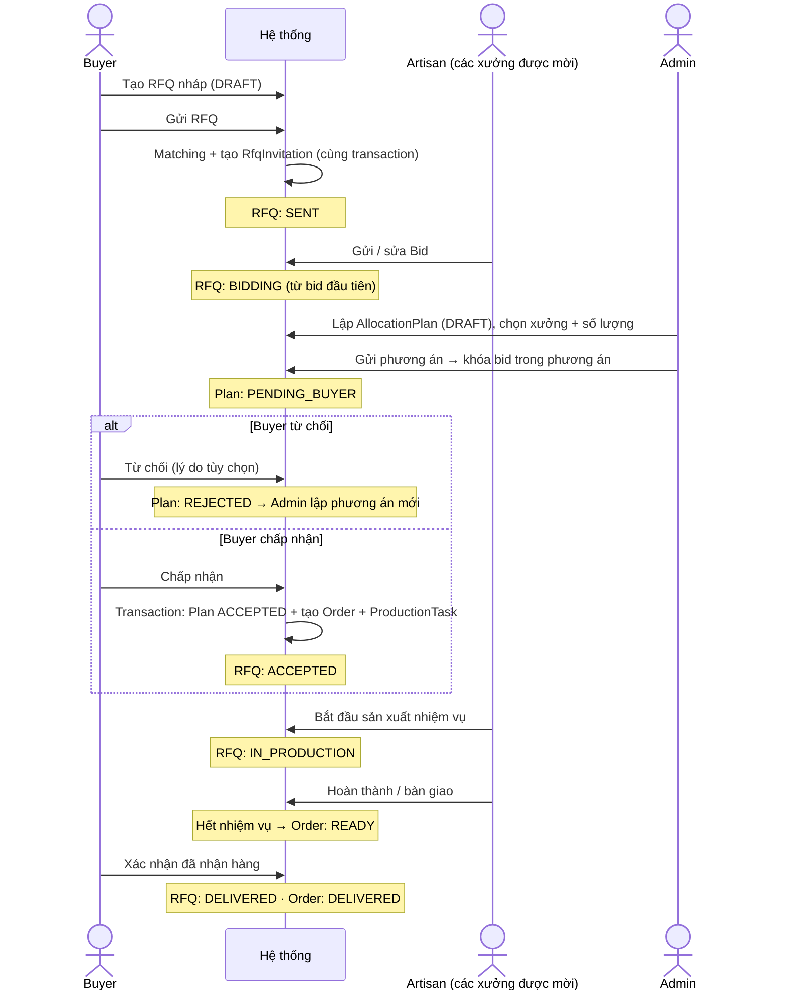
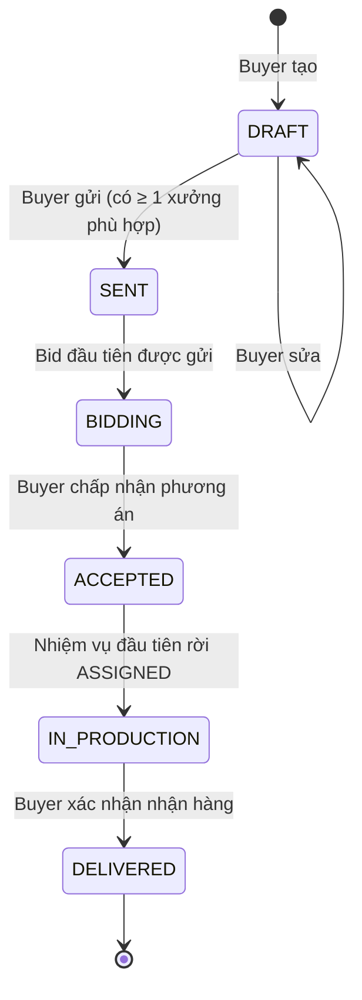
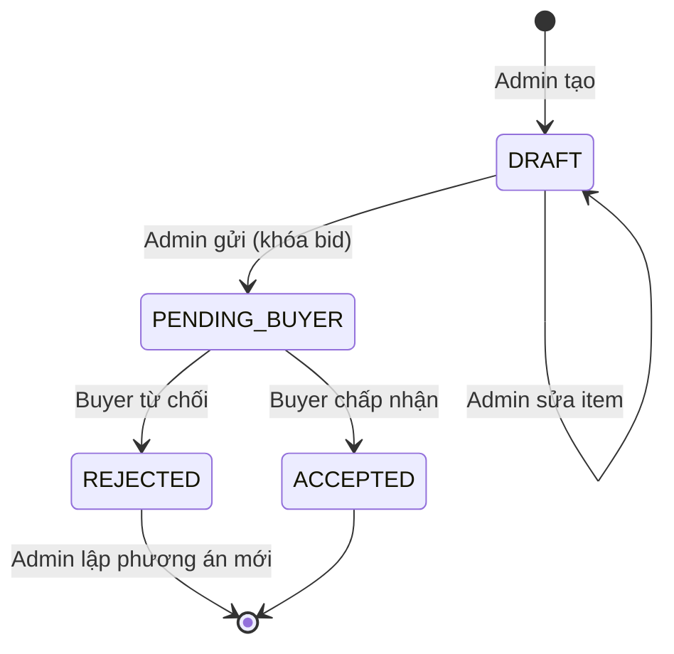
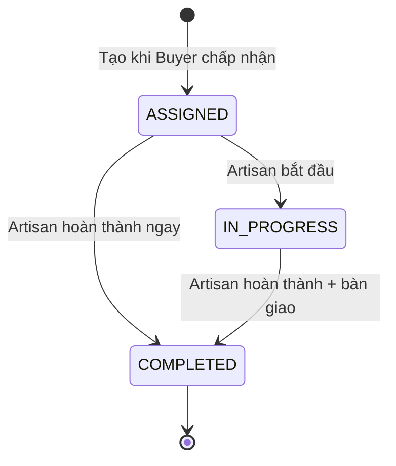

# 04 — Luồng báo giá và điều phối đơn (Quotation Flow)

Tài liệu này mô tả **state machine** của RFQ, phương án chia đơn, đơn hàng và nhiệm vụ; các quy tắc chuyển trạng thái; và cách **khóa bản ghi** để chống xử lý trùng (TECH-03).

**Phụ trách:** N3 (state machine, lời mời, báo giá, phương án: N3-T1-01, N3-T1-07, N3-T3-xx) · N1 (RFQ, duyệt phương án, tạo đơn: N1-T2-04..06, N1-T3-04..07) · N2 (nhiệm vụ, tiến độ: N2-T3-08, N2-T4-04..06).

> Tên bảng và cột theo `03-database.md`. Mỗi Artisan sở hữu đúng **1 xưởng** (`Workshop.ownerId` UNIQUE), nên các API của Artisan lấy `workshopId` từ phiên đăng nhập.

---

## 1. Tổng quan



| Thực thể | Bảng | Vai trò trong luồng |
|----------|------|---------------------|
| RFQ | `Rfq` | Nhu cầu của Buyer; trạng thái chính hiển thị cho mọi vai trò |
| Lời mời | `RfqInvitation` | RFQ đã gửi tới xưởng nào |
| Báo giá | `Bid` | Mỗi xưởng tối đa 1 bid cho mỗi RFQ |
| Phương án | `AllocationPlan`, `AllocationPlanItem` | Cách chia số lượng cho các xưởng, do Admin lập |
| Đơn hàng | `Order` | Mỗi RFQ chỉ có tối đa 1 đơn |
| Nhiệm vụ | `ProductionTask` | Phần việc của một xưởng trong đơn |

## 2. State machine của RFQ



### 2.1. Bảng chuyển trạng thái

| # | Từ → Đến | Kích hoạt | Ai | Điều kiện (guard) | Hệ quả (cùng transaction) |
|---|----------|-----------|----|-------------------|---------------------------|
| R1 | — → `DRAFT` | `POST /api/rfqs` | Buyer | Zod hợp lệ | Sinh `code`; tự điền `contactName/Phone` từ User |
| R2 | `DRAFT` → `DRAFT` | `PATCH /api/rfqs/:id` | Buyer chủ RFQ | `status = DRAFT` | Cập nhật các trường |
| R3 | `DRAFT` → `SENT` | `POST /api/rfqs/:id/send` | Buyer chủ RFQ | Kiểm tra lại toàn bộ bằng Zod; `bidDeadline > now`; `requiredBy > bidDeadline`; matching có **≥ 1 xưởng** | Tạo `RfqInvitation` cho từng xưởng phù hợp; đặt `sentAt` |
| R4 | `SENT` → `BIDDING` | Khi bid **đầu tiên** được tạo | Hệ thống | `status = SENT` | Chạy trong transaction tạo bid |
| R5 | `BIDDING` → `ACCEPTED` | `POST /api/plans/:id/accept` | Buyer chủ RFQ | Phương án đang `PENDING_BUYER` | Xem mục 6 |
| R6 | `ACCEPTED` → `IN_PRODUCTION` | Một nhiệm vụ rời trạng thái `ASSIGNED` | Hệ thống | `status = ACCEPTED` | Chạy trong transaction cập nhật nhiệm vụ |
| R7 | `IN_PRODUCTION` → `DELIVERED` | `POST /api/orders/:id/confirm-received` | Buyer chủ đơn | `Order.status = READY` | `Order → DELIVERED`, đặt `receivedAt` |

Mọi chuyển trạng thái khác (ví dụ `DRAFT → DELIVERED`, quay lùi) đều bị server từ chối với **409 `INVALID_TRANSITION`**.

### 2.2. Quy tắc sửa RFQ sau khi gửi (N1-T2-06)

| Trường | `DRAFT` | `SENT`, `BIDDING` | Từ `ACCEPTED` trở đi |
|--------|---------|-------------------|---------------------|
| `title`, `categoryId`, `quantity`, `unit`, `bidDeadline`, `requiredBy`, `budgetMax`, `description` | Sửa được | **Khóa**, vì lời mời và báo giá đã dựa trên các trường này | Khóa |
| `contactName`, `contactPhone`, `deliveryAddress` | Sửa được | Sửa được | Khóa |

Muốn đổi số lượng hoặc danh mục sau khi đã gửi thì Buyer phải tạo RFQ mới. Hệ thống không có trạng thái hủy (xem `01-requirements.md`, mục 6).

## 3. Matching và lời mời (N3-T1-07, N3-T2-01, N3-T2-02)

### 3.1. Quy tắc chọn xưởng phù hợp

Một xưởng **phù hợp** với RFQ khi đồng thời thỏa mãn:
1. `Workshop.status = 'APPROVED'`
2. `Workshop.acceptsOrders = true`
3. Có bản ghi `WorkshopCategory` với `categoryId = Rfq.categoryId`

```js
// invitations.repository.js — dùng tx để chạy chung transaction với bước gửi RFQ
findMatchingWorkshops(tx, categoryId) {
  return tx.workshop.findMany({
    where: {
      status: 'APPROVED',
      acceptsOrders: true,
      categories: { some: { categoryId } },   // quan hệ Workshop → WorkshopCategory
    },
    select: { id: true },
  });
}
```

### 3.2. Gửi RFQ và tạo lời mời: một transaction

1. Update có điều kiện `Rfq: DRAFT → SENT` với `where: { id, buyerId, status: 'DRAFT' }`. Nếu `count = 0` thì trả 409 (RFQ đã được gửi, hoặc không phải RFQ của mình).
2. Gọi matching. Nếu **không có xưởng nào** thì ném lỗi **422 `NO_MATCHING_WORKSHOP`**, toàn bộ transaction rollback và RFQ vẫn ở `DRAFT`. Giao diện gợi ý Buyer đổi danh mục.
3. `tx.rfqInvitation.createMany({ data, skipDuplicates: true })`. Ràng buộc UNIQUE `(rfqId, workshopId)` bảo đảm không mời trùng.

> **Vì sao không cho RFQ vào `SENT` khi không có xưởng nào?** Vì RFQ đó sẽ nằm mãi ở `SENT`, không ai chào giá được, trong khi hệ thống không có trạng thái hủy.

### 3.3. Trạng thái lời mời

`INVITED` → `VIEWED` (Artisan mở chi tiết lần đầu, đặt `viewedAt`) → `BID_SUBMITTED` (Artisan gửi bid lần đầu).

Artisan **chỉ thấy RFQ có lời mời cho xưởng mình**. Mọi truy vấn đều lọc theo `workshopId` của người đang đăng nhập. Đổi ID trong URL sang RFQ không được mời thì nhận **404** (không trả 403, để không lộ việc RFQ đó tồn tại).

## 4. Báo giá (N3-T2-04, N3-T2-05)

**API:** `PUT /api/rfqs/:id/bids/mine` (upsert). Lần đầu gọi thì tạo bid, các lần sau thì cập nhật. Vì UNIQUE `(rfqId, workshopId)` nên mỗi xưởng không thể có hai bid cho cùng một RFQ.

**Điều kiện tạo hoặc sửa bid:**

| Điều kiện | Lỗi nếu vi phạm |
|-----------|-----------------|
| Xưởng `APPROVED` và có `RfqInvitation` cho RFQ này | 404 `RFQ_NOT_FOUND` |
| `Rfq.status ∈ {SENT, BIDDING}` | 409 `RFQ_NOT_OPEN` |
| `now ≤ Rfq.bidDeadline` | 409 `BID_DEADLINE_PASSED` |
| Bid hiện tại có `lockedAt IS NULL` (khi sửa) | 409 `BID_LOCKED` |
| `quantityOffered` nguyên, `1 ≤ quantityOffered ≤ Rfq.quantity`; `unitPrice > 0`; `leadTimeDays` nguyên dương | 400 `VALIDATION_ERROR` |

**Trong transaction gửi bid:**
- Upsert bid. Khi sửa, dùng `updateMany({ where: { id, lockedAt: null } })` và kiểm tra `count = 1` (xem mục 7.2).
- Chuyển `RfqInvitation.status → BID_SUBMITTED`.
- `Rfq: SENT → BIDDING`: update có điều kiện `where: { id, status: 'SENT' }`. Nếu `count = 0` thì cũng không sao (RFQ đã ở `BIDDING`).

**Bảng so sánh báo giá (N3-T2-06):** gồm xưởng, số lượng, đơn giá, thời gian và thành tiền (`quantityOffered × unitPrice`). Thành tiền **do server tính** bằng `Decimal`. Buyer chỉ xem được bid của RFQ mình sở hữu; Admin xem được tất cả.

## 5. Phương án chia đơn (N3-T3-01..06, N3-T4-06)



| # | Từ → Đến | API | Ai | Điều kiện | Hệ quả |
|---|----------|-----|----|-----------|--------|
| P1 | — → `DRAFT` | `POST /api/rfqs/:id/plans` | Admin | `Rfq.status = BIDDING`; chưa có phương án `DRAFT`, `PENDING_BUYER` hoặc `ACCEPTED` (đã có partial unique index chặn) | Tạo phương án rỗng |
| P2 | `DRAFT` → `DRAFT` | `PUT /api/plans/:id/items` | Admin | `status = DRAFT` | Thay toàn bộ danh sách item; server tính lại `lineTotal`, `totalQuantity`, `totalAmount` |
| P3 | `DRAFT` → `PENDING_BUYER` | `POST /api/plans/:id/send` | Admin | Kiểm tra lại toàn bộ (mục 5.1) **sau khi đã khóa bid** | Đặt `lockedAt` cho các bid trong phương án, đặt `sentAt` |
| P4 | `PENDING_BUYER` → `ACCEPTED` | `POST /api/plans/:id/accept` | Buyer chủ RFQ | Xem mục 6 | Tạo đơn |
| P5 | `PENDING_BUYER` → `REJECTED` | `POST /api/plans/:id/reject` | Buyer chủ RFQ | `status = PENDING_BUYER` | Lưu `rejectReason` (tùy chọn), `decidedAt`; **mở khóa** các bid của phương án (`lockedAt = null`) |

Phương án `PENDING_BUYER`, `ACCEPTED` và `REJECTED` là **bất biến**: mọi API sửa item đều trả 409 `PLAN_LOCKED`. Không có hệ thống version. Sau khi phương án bị từ chối, Admin tạo một phương án mới (P1).

Sau khi bị từ chối, bid được mở khóa. Xưởng có thể sửa lại bid nếu **chưa quá `bidDeadline`**. Nếu đã quá hạn, Admin lập phương án mới từ các bid hiện có.

### 5.1. Kiểm tra phương án ở server (N3-T3-03..05)

Chạy khi lưu item (P2) và **chạy lại** khi gửi (P3), vì bid có thể đã bị sửa trong lúc phương án còn là nháp:

| Kiểm tra | Lỗi |
|----------|-----|
| Mỗi `bidId` thuộc **đúng RFQ** của phương án, `status = SUBMITTED` | 409 `BID_NOT_VALID_FOR_RFQ` |
| Không có hai item cùng `bidId` | 400 `DUPLICATE_BID` |
| `quantity` là số nguyên dương (không âm, không lẻ, không bằng 0) | 400 `VALIDATION_ERROR` |
| `quantity ≤ bid.quantityOffered` | 400 `EXCEEDS_COMMITMENT` |
| `Σ quantity = Rfq.quantity` | 400 `QUANTITY_SHORT` / `QUANTITY_OVER` |
| Khi gửi: `item.unitPrice` vẫn bằng `bid.unitPrice` hiện tại | 409 `PLAN_STALE`, Admin phải lưu lại phương án |

`unitPrice` của item được **chép từ bid ở server**, không nhận từ client. `lineTotal = quantity × unitPrice` và `totalAmount = Σ lineTotal` được tính bằng `Prisma.Decimal` (`.mul()`, `.add()`), không dùng phép tính số thực của JavaScript.

## 6. Buyer chấp nhận phương án và tạo đơn (N1-T3-05..07, N3-T3-08)

Đây là bước quan trọng nhất. Mọi việc chạy trong **một interactive transaction**:

```js
// orders.service.js
import { Prisma } from '@prisma/client';

export async function acceptPlan(planId, buyerId) {
  try {
    return await prisma.$transaction(async (tx) => {
      // 1. Compare-and-set: chỉ 1 request thắng
      const plan = await tx.allocationPlan.findUnique({
        where: { id: planId },
        include: { rfq: true, items: true },
      });
      if (!plan || plan.rfq.buyerId !== buyerId) throw new AppError(404, 'PLAN_NOT_FOUND');

      const { count } = await tx.allocationPlan.updateMany({
        where: { id: planId, status: 'PENDING_BUYER' },
        data: { status: 'ACCEPTED', decidedAt: new Date() },
      });
      if (count !== 1) return alreadyProcessed(tx, plan);   // xem 6.1

      // 2. Kiểm tra lại RFQ
      const rfq = await tx.rfq.updateMany({
        where: { id: plan.rfqId, status: 'BIDDING' },
        data: { status: 'ACCEPTED' },
      });
      if (rfq.count !== 1) throw new AppError(409, 'RFQ_NOT_BIDDING');

      // 3. Tạo đơn — UNIQUE(rfqId), UNIQUE(planId) là lớp chặn cuối
      const order = await tx.order.create({
        data: {
          code: await nextOrderCode(tx),
          rfqId: plan.rfqId, planId, buyerId,
          totalAmount: plan.totalAmount,
        },
      });

      // 4. Tạo đủ nhiệm vụ cho từng xưởng
      await tx.productionTask.createMany({
        data: plan.items.map((it) => ({
          orderId: order.id, workshopId: it.workshopId, planItemId: it.id,
          quantity: it.quantity, unitPrice: it.unitPrice, dueDate: it.dueDate,
        })),
      });

      // 5. Khóa và chốt trạng thái các bid
      const chosen = plan.items.map((it) => it.bidId);
      const now = new Date();
      await tx.bid.updateMany({ where: { id: { in: chosen } }, data: { status: 'ACCEPTED', lockedAt: now } });
      await tx.bid.updateMany({
        where: { rfqId: plan.rfqId, id: { notIn: chosen } },
        data: { status: 'REJECTED', lockedAt: now },
      });

      return order;
    });
  } catch (e) {
    if (e instanceof Prisma.PrismaClientKnownRequestError && e.code === 'P2002') {
      throw new AppError(409, 'ORDER_ALREADY_EXISTS');
    }
    throw e;
  }
}
```

**Bảo đảm:**
- Bất kỳ bước nào ném lỗi thì Prisma rollback toàn bộ, không có đơn nào bị tạo dở (N1-T3-07, N1-T5-04).
- Hai request đồng thời: request thứ hai bị chặn ở bước 1. Ngay cả khi lọt qua bước 1, bước 3 vẫn vi phạm UNIQUE nên trả 409 (N1-T5-03).
- `alreadyProcessed`, `nextOrderCode` và `AppError` là hàm tiện ích do nhóm tự viết.

### 6.1. Idempotency khi duyệt lặp

Khi update có điều kiện ở bước 1 trả `count = 0`, đọc lại phương án:

| Trạng thái hiện tại | Phản hồi |
|---------------------|----------|
| `ACCEPTED` và đã có `Order` | **200**, trả lại đơn hiện có kèm `alreadyProcessed: true`. Buyer bấm hai lần hay refresh vẫn nhận đúng kết quả |
| `REJECTED` | 409 `PLAN_REJECTED` |
| `DRAFT` | 409 `PLAN_NOT_SENT` |

Nút "Chấp nhận" ở frontend bị vô hiệu hóa trong lúc chờ phản hồi. Đây chỉ là hỗ trợ trải nghiệm; server mới là nơi bảo đảm.

## 7. Khóa bản ghi và xử lý đồng thời

### 7.1. Chiến lược

| Kỹ thuật | Dùng ở đâu | Nguyên lý |
|----------|------------|-----------|
| **Update có điều kiện** (compare-and-set): `updateMany({ where: { id, status: X } })` rồi kiểm tra `count` | Mọi bước chuyển trạng thái | Câu `UPDATE` của PostgreSQL khóa dòng. Request đến sau phải chờ, rồi thấy điều kiện không còn đúng nên `count = 0` |
| **Ràng buộc UNIQUE** | `Order.rfqId`, `Order.planId`, `RfqInvitation(rfqId, workshopId)`, `Bid(rfqId, workshopId)`, partial index cho phương án | Lớp chặn cuối ở CSDL. Lỗi `P2002` được chuyển thành 409 |
| **`SELECT ... FOR UPDATE`** qua `tx.$queryRaw` | Khi phải đếm trên nhiều dòng rồi mới quyết định (mục 7.3) | Khóa dòng cha để các transaction chạy tuần tự |
| **Transaction** | Mọi thao tác ghi nhiều bảng | Hoặc ghi hết, hoặc không ghi gì |

Mức cô lập dùng mặc định của PostgreSQL (`READ COMMITTED`). Các kỹ thuật trên đủ cho các tình huống bên dưới mà không cần `SERIALIZABLE`.

### 7.2. Các tình huống tranh chấp

| # | Tình huống | Xử lý | Kết quả |
|---|------------|-------|---------|
| C1 | Buyer bấm "Chấp nhận" hai lần hoặc mở hai tab | Compare-and-set `PENDING_BUYER → ACCEPTED` + UNIQUE `Order.rfqId` | Chỉ tạo 1 đơn; request sau nhận 200 `alreadyProcessed` |
| C2 | Buyer gửi RFQ hai lần | Compare-and-set `DRAFT → SENT` + UNIQUE lời mời | Lời mời không bị tạo trùng |
| C3 | Hai Admin cùng tạo phương án cho một RFQ | Partial unique index `AllocationPlan_active_per_rfq` | Người sau nhận 409 `PLAN_EXISTS` |
| C4 | Admin gửi phương án **đúng lúc** Artisan đang sửa bid | Transaction gửi phương án: **khóa bid trước** (`updateMany({ where: { id: { in }, lockedAt: null }, data: { lockedAt } })`), sau đó mới đọc lại bid để kiểm tra. Sửa bid dùng `updateMany({ where: { id, lockedAt: null } })` | Nếu Artisan commit trước, bước kiểm tra của Admin thấy giá mới và trả `PLAN_STALE`. Nếu Admin khóa trước, lệnh sửa của Artisan phải chờ, sau đó `count = 0` và nhận `BID_LOCKED` |
| C5 | Buyer chấp nhận đúng lúc Buyer từ chối (hai tab) | Cả hai đều compare-and-set trên `status = PENDING_BUYER` | Chỉ một request thắng; request kia nhận 409 |
| C6 | Hai xưởng hoàn thành nhiệm vụ **cuối cùng** cùng lúc | Xem mục 7.3 | Đơn chắc chắn chuyển sang `READY` đúng một lần |
| C7 | Artisan sửa nhiệm vụ của xưởng khác bằng cách đổi ID | Service lọc theo `workshopId` của người đang đăng nhập | 404 |

### 7.3. Đơn sang `READY`: vì sao cần `FOR UPDATE`

Nếu chỉ "cập nhật nhiệm vụ của mình, rồi đếm số nhiệm vụ chưa xong", thì với `READ COMMITTED`, khi hai xưởng hoàn thành đồng thời, mỗi transaction đều thấy nhiệm vụ của xưởng kia **chưa xong** (vì transaction kia chưa commit). Kết quả là không transaction nào chuyển đơn sang `READY`.

Cách khắc phục: **khóa dòng `Order` trước**, để các lần cập nhật nhiệm vụ của cùng một đơn chạy tuần tự:

```js
await prisma.$transaction(async (tx) => {
  await tx.$queryRaw`SELECT id FROM "Order" WHERE id = ${orderId}::uuid FOR UPDATE`;
  // ... cập nhật nhiệm vụ (compare-and-set theo status) ...
  const remaining = await tx.productionTask.count({
    where: { orderId, status: { not: 'COMPLETED' } },
  });
  if (remaining === 0) {
    await tx.order.updateMany({ where: { id: orderId, status: 'IN_PRODUCTION' }, data: { status: 'READY' } });
  }
});
```

Prisma Client không có API riêng cho `FOR UPDATE`, nên dùng `$queryRaw`. Tên bảng `"Order"` phải đặt trong nháy kép.

## 8. Đơn hàng và nhiệm vụ (N2-T3-08, N2-T4-04..06, N1-T4-01..03)

### 8.1. Nhiệm vụ sản xuất



**API:** `PATCH /api/tasks/:id/progress`, body `{ status?, completedQuantity?, progressNote? }`.

| Quy tắc | Lỗi |
|---------|-----|
| Chỉ xưởng sở hữu nhiệm vụ được cập nhật | 404 |
| Trạng thái chỉ đi tiến, không lùi | 409 `INVALID_TRANSITION` |
| `0 ≤ completedQuantity ≤ quantity`; khi chuyển `COMPLETED` thì tự đặt `completedQuantity = quantity` | 400 |
| Không sửa được khi nhiệm vụ đã `COMPLETED` | 409 `TASK_COMPLETED` |
| Đặt `startedAt` khi rời `ASSIGNED`, `completedAt` khi chuyển `COMPLETED` | — |

**Đồng bộ trạng thái trong cùng transaction** (sau khi đã khóa `Order`, mục 7.3):
- Nhiệm vụ rời `ASSIGNED` → `Rfq: ACCEPTED → IN_PRODUCTION` (compare-and-set; nếu `count = 0` thì RFQ đã ở `IN_PRODUCTION`, bỏ qua).
- Mọi nhiệm vụ đã `COMPLETED` → `Order: IN_PRODUCTION → READY`.

### 8.2. Đơn hàng

| Order | RFQ | Ý nghĩa với Buyer |
|-------|-----|-------------------|
| `IN_PRODUCTION` | `ACCEPTED` | Đã chốt, các xưởng chưa bắt đầu |
| `IN_PRODUCTION` | `IN_PRODUCTION` | Đang sản xuất; tiến độ = `Σ completedQuantity / Σ quantity` |
| `READY` | `IN_PRODUCTION` | Mọi xưởng đã bàn giao, chờ Buyer xác nhận |
| `DELIVERED` | `DELIVERED` | Hoàn tất |

**Xác nhận nhận hàng** (`POST /api/orders/:id/confirm-received`): compare-and-set `Order: READY → DELIVERED` với `where: { id, buyerId, status: 'READY' }`, kèm `Rfq → DELIVERED` và `receivedAt = now`. **Artisan không gọi được API này** (`requireRole('BUYER')`), đúng yêu cầu N2-T4-06.

Giao diện phải hiển thị tiến độ **từng xưởng** và **toàn đơn** riêng biệt. Một xưởng đã `COMPLETED` không có nghĩa là cả đơn đã xong (N1-T4-02).

## 9. Danh sách API của luồng

| Method | Path | Vai trò | Bước |
|--------|------|---------|------|
| POST | `/api/rfqs` | Buyer | R1 |
| PATCH | `/api/rfqs/:id` | Buyer | R2 |
| POST | `/api/rfqs/:id/send` | Buyer | R3 |
| GET | `/api/rfqs?status=&page=` | Buyer (của mình), Admin (tất cả) | — |
| GET | `/api/rfqs/:id` | Buyer chủ RFQ, Admin, Artisan có lời mời | — |
| GET | `/api/invitations?status=` | Artisan | — |
| GET | `/api/invitations/:id` | Artisan | `INVITED → VIEWED` |
| PUT | `/api/rfqs/:id/bids/mine` | Artisan | Tạo/sửa bid, R4 |
| GET | `/api/rfqs/:id/bids` | Buyer chủ RFQ, Admin | Bảng so sánh |
| POST | `/api/rfqs/:id/plans` | Admin | P1 |
| PUT | `/api/plans/:id/items` | Admin | P2 |
| POST | `/api/plans/:id/send` | Admin | P3 |
| GET | `/api/rfqs/:id/plans/current` | Buyer chủ RFQ, Admin | — |
| POST | `/api/plans/:id/accept` | Buyer | P4 + R5 |
| POST | `/api/plans/:id/reject` | Buyer | P5 |
| GET | `/api/orders`, `/api/orders/:id` | Buyer (của mình), Admin | — |
| GET | `/api/tasks?status=` | Artisan | — |
| PATCH | `/api/tasks/:id/progress` | Artisan | R6, chuyển đơn sang READY |
| POST | `/api/orders/:id/confirm-received` | Buyer | R7 |

## 10. Mã lỗi nghiệp vụ

| HTTP | Mã | Khi nào |
|------|----|---------|
| 400 | `VALIDATION_ERROR` | Zod không hợp lệ |
| 400 | `QUANTITY_SHORT`, `QUANTITY_OVER`, `EXCEEDS_COMMITMENT`, `DUPLICATE_BID` | Phương án sai số lượng |
| 404 | `RFQ_NOT_FOUND`, `PLAN_NOT_FOUND`, `ORDER_NOT_FOUND`, `TASK_NOT_FOUND` | Không tồn tại **hoặc** không có quyền xem |
| 409 | `INVALID_TRANSITION` | Chuyển trạng thái không hợp lệ |
| 409 | `RFQ_NOT_OPEN`, `BID_DEADLINE_PASSED`, `BID_LOCKED` | Không gửi hoặc sửa được bid |
| 409 | `PLAN_EXISTS`, `PLAN_LOCKED`, `PLAN_STALE`, `PLAN_REJECTED`, `PLAN_NOT_SENT` | Phương án |
| 409 | `BID_NOT_VALID_FOR_RFQ` | Bid khác RFQ hoặc không còn hợp lệ |
| 409 | `ORDER_ALREADY_EXISTS`, `RFQ_NOT_BIDDING` | Duyệt trùng |
| 409 | `TASK_COMPLETED` | Sửa nhiệm vụ đã xong |
| 422 | `NO_MATCHING_WORKSHOP` | Gửi RFQ khi không có xưởng phù hợp |

## 11. Ca kiểm thử bắt buộc

| # | Ca | Kỳ vọng | Mã việc |
|---|----|---------|---------|
| T1 | Gửi RFQ thuộc danh mục không có xưởng nào | 422; RFQ vẫn `DRAFT` | N3-T4-03 |
| T2 | Gửi RFQ hai lần liên tiếp | Lần 2 nhận 409; lời mời không bị trùng | N3-T4-03 |
| T3 | Gọi API chuyển `DRAFT → DELIVERED` hoặc chấp nhận phương án khi RFQ đang `SENT` | 409 | N3-T4-03 |
| T4 | Xưởng không được mời gửi bid; gửi sau hạn; sửa bid đã khóa | 404 / 409 / 409 | N3-T5-01 |
| T5 | Phương án chia thiếu, vượt, số âm, số lẻ, vượt cam kết; dùng bid của RFQ khác | 400 / 409; không lưu | N3-T5-02, N1-T6-06 |
| T6 | Sửa bid sau khi Admin lưu phương án nháp, rồi Admin gửi | 409 `PLAN_STALE` | N1-T6-06 |
| T7 | Gửi **đồng thời** 2 request accept (dùng `Promise.all` hoặc 2 lệnh curl chạy song song) | Đúng 1 `Order`, đủ nhiệm vụ, không nhân đôi | N1-T5-03 |
| T8 | Ép lỗi giữa transaction (ví dụ nhiệm vụ có `quantity = 0` làm vi phạm CHECK) | Không còn `Order` nào trong CSDL; phương án vẫn `PENDING_BUYER` | N1-T5-04 |
| T9 | Từ chối phương án → Admin tạo phương án mới → chấp nhận | Thành công; phương án cũ không duyệt được | N3-T5-03 |
| T10 | Buyer B gọi accept phương án của Buyer A | 404 | N1-T5-02 |
| T11 | Hai xưởng hoàn thành nhiệm vụ cuối cùng đồng thời | Đơn sang `READY` | N2-T5-04 |
| T12 | Artisan gọi `confirm-received` | 403 | N2-T4-06 |

## 12. Các quyết định đang chờ chốt

| # | Vấn đề | Lựa chọn tạm trong tài liệu này |
|---|--------|---------------------------------|
| 1 | RFQ không có xưởng phù hợp | Không cho gửi: 422, RFQ giữ `DRAFT` |
| 2 | `ACCEPTED → IN_PRODUCTION` diễn ra khi nào | Khi nhiệm vụ đầu tiên rời `ASSIGNED`. Phương án thay thế: chuyển ngay khi tạo đơn, khi đó `ACCEPTED` chỉ là trạng thái thoáng qua |
| 3 | Bid có được sửa lại sau khi phương án bị từ chối | Được, nếu còn trước `bidDeadline` |
| 4 | Không có bid nào trước `bidDeadline` | RFQ ở lại `SENT`; không có trạng thái hết hạn (ngoài phạm vi). Admin có thể can thiệp mời thêm xưởng (ADM-08, tùy chọn) |