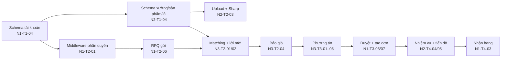

# 08 — Quy trình làm việc nhóm (Team Workflow)

Nhóm 3 người, 6 tuần (09/11 – 14/12/2026), chấm bằng demo và vấn đáp. Tài liệu này chốt **ai làm gì, làm theo thứ tự nào, code và review ra sao**, để ba người làm song song mà không giẫm chân nhau. Danh sách việc chi tiết nằm ở bảng phân công. Tài liệu này không chép lại bảng đó, chỉ dùng mã việc để tham chiếu.

---

## 1. Vai trò và phạm vi

| Thành viên | Phạm vi | Module backend | Khu vực giao diện |
|-----------|---------|----------------|-------------------|
| **N1** | Tài khoản, RFQ và đơn hàng phía Buyer | `auth`, `rfq`, `orders` | Đăng nhập/đăng ký, app shell và router, trang chủ (ghép dữ liệu), RFQ, đơn hàng, trang truy xuất `/truy-xuat/:maLo`, bộ lọc catalog |
| **N2** *(trưởng nhóm)* | Hồ sơ xưởng, sản phẩm, QR, bản đồ, sản xuất | `workshops`, `products`, `media`, `batches`, `trace`, `tasks` | Design system, trang chủ (thiết kế), khám phá, chi tiết sản phẩm, hồ sơ xưởng, bản đồ, khu vực Artisan |
| **N3** | Lời mời, báo giá, chia đơn, quản trị | `invitations`, `bids`, `plans`, `news`, `admin` | Khu vực Admin, form báo giá, bảng so sánh báo giá, tin cộng đồng |

### 1.1. Thành phần dùng chung: ai giữ, ai được sửa

| Thành phần | Người giữ | Quy tắc |
|-----------|-----------|---------|
| `middlewares/requireAuth`, `requireRole`, `validate`, `csrf`, `errorHandler` | N1 | Người khác cần thay đổi thì mở issue hoặc PR, N1 review |
| `frontend/src/api/client.js`, `AuthContext`, router, layout | N1 | |
| `styles/tokens.css`, `components/` dùng chung | N2 | Cần component mới thì báo N2. Không tự thêm màu hay cỡ chữ ngoài token |
| Media service (upload + Sharp) | N2 | Mọi upload đều đi qua service này |
| `prisma/schema.prisma` | Mỗi người giữ phần model của mình (theo `03-database.md`) | Sửa model của người khác thì PR **phải** được người đó duyệt |
| `docs/` | Người viết từng file | Đổi API hoặc schema thì cập nhật tài liệu tương ứng **trong cùng PR** |

## 2. Lộ trình 6 tuần

| Tuần | Hạn | Mục tiêu tuần | Điểm ghép bắt buộc cuối tuần |
|------|-----|---------------|------------------------------|
| **1. Nền tảng** | 09/11 | Khởi tạo repo, schema, migration, auth, khung giao diện, design system, upload cơ bản | Cả 3 chạy được `migrate` + `seed`; đăng nhập được 3 vai trò; schema đầy đủ không xung đột |
| **2. Chức năng độc lập** | 16/11 | Mỗi người hoàn thành phần riêng: CRUD sản phẩm và catalog (N2), RFQ nháp và gửi (N1), matching, lời mời, báo giá (N3) | Buyer gửi RFQ thì xưởng phù hợp thấy lời mời |
| **3. Luồng nghiệp vụ chính** | 23/11 | Lô, nhật ký, QR (N2); phương án (N3); duyệt phương án và tạo đơn (N1) | **MVP RFQ end-to-end** (N3-T3-07): Buyer gửi → tự mời → chào giá → Admin chia → Buyer chấp nhận → có đơn thật, **không sửa DB bằng tay** |
| **4. Kết nối toàn hệ thống** | 30/11 | Bản đồ, tiến độ sản xuất, dashboard Admin, tin tức, bộ lọc catalog | Luồng đầy đủ tới **xác nhận nhận hàng**; bản đồ và trang truy xuất hoạt động |
| **5. Hoàn thiện và kiểm thử** | 07/12 | Kiểm thử quyền, đồng thời, rollback, upload; responsive và accessibility; chạy demo trên mạng LAN | Toàn bộ ca kiểm thử trong `04-quotation-flow.md` mục 11 đạt; QR quét được bằng điện thoại thật |
| **6. Nghiệm thu và bàn giao** | 14/12 | Seed hoàn chỉnh, README, sửa lỗi cuối, tập demo và vấn đáp | Một người **không viết code** chạy được dự án chỉ bằng README (N3-T6-04); diễn tập demo đầy đủ |

### 2.1. Đường găng (critical path)

Đây là những việc mà nếu trễ sẽ chặn công việc của người khác. Ưu tiên làm xong sớm:



**Cách tránh chờ nhau:** khi API của người khác chưa xong, frontend tạm dùng **dữ liệu giả có đúng shape trong `05-api.md`** (để trong `features/*/mocks.js`), rồi chuyển sang API thật khi ghép. Không dựng mock server riêng.

## 3. Quy trình Git

### 3.1. Nhánh

- `main` luôn **chạy được**. Không ai push thẳng lên `main`.
- Mỗi việc làm trên một nhánh riêng, tách từ `main` mới nhất:

| Loại | Mẫu tên nhánh | Ví dụ |
|------|---------------|-------|
| Tính năng | `feat/<mã-việc>-<mô-tả>` | `feat/n2-t2-01-product-crud` |
| Sửa lỗi | `fix/<mô-tả>` | `fix/trace-404-hidden-batch` |
| Tài liệu | `docs/<mô-tả>` | `docs/quotation-flow` |
| Seed, cấu hình | `chore/<mô-tả>` | `chore/seed-workshops` |

- Nhánh nên sống **ngắn (1–3 ngày)**. Việc lớn thì chia thành nhiều PR nhỏ.
- Trước khi mở PR: `git fetch && git rebase origin/main` (hoặc merge `main` vào nhánh), rồi chạy lại ứng dụng để kiểm tra.

### 3.2. Commit

Theo dạng Conventional Commits, mô tả viết tiếng Việt hoặc tiếng Anh nhưng thống nhất trong cả repo:

```
feat(products): thêm API tạo và sửa sản phẩm
fix(trace): trả 404 khi lô chưa công khai
refactor(rfq): tách kiểm tra trạng thái ra service
docs(api): bổ sung endpoint đổi thứ tự mốc
chore(seed): thêm 8 xưởng mẫu
```

Mỗi commit chỉ làm một việc; không commit `.env`, `node_modules`, `uploads/` hay `dist/`.

### 3.3. Pull Request

- Tiêu đề: `[N2-T2-01] CRUD sản phẩm và kiểm tra chủ xưởng`.
- **Cần ít nhất 1 người duyệt** trước khi merge. Người duyệt mặc định:

| Người viết PR | Người review chính | Căn cứ bảng phân công |
|---------------|--------------------|-----------------------|
| N1 | N2 | N2-T4-08 |
| N2 | N3 | N3-T4-08 |
| N3 | N1 | N1-T6-06 |

  PR sửa thành phần dùng chung hoặc model của người khác thì thêm người giữ thành phần đó vào review.
- Merge bằng **squash merge**. Xóa nhánh sau khi merge.
- PR treo quá 24 giờ thì nhắc trong nhóm chat. Người review cố gắng phản hồi trong ngày.

**Mẫu mô tả PR** (`.github/pull_request_template.md`):

```markdown
## Mã việc
N?-T?-??

## Thay đổi
- …

## Cách kiểm tra
1. …
2. Thử trường hợp sai quyền: …

## Checklist
- [ ] Đạt "Điều kiện nghiệm thu" trong bảng phân công
- [ ] Server validate bằng Zod và kiểm tra quyền sở hữu
- [ ] UI có loading / empty / error
- [ ] Có migration (nếu đổi schema) và đã chạy thử `migrate reset`
- [ ] Đã cập nhật docs/ (nếu đổi API hoặc schema)
```

### 3.4. Migration khi làm nhóm

Nhiều người cùng sửa `schema.prisma` dễ gây xung đột migration. Quy tắc:

1. **Pull `main` trước khi chạy `migrate dev`**, để migration mới luôn nằm sau các migration đã merge.
2. **Mỗi PR có tối đa một migration**, đặt tên rõ ràng.
3. Nếu `main` có migration mới trong lúc PR của mình đang mở: xóa thư mục migration của mình, rebase lên `main`, chạy `npx prisma migrate reset`, rồi tạo lại migration.
4. Không sửa migration đã nằm trên `main`.
5. Tuần 1 ưu tiên **chốt sớm toàn bộ schema** (dựa trên `03-database.md`), để các tuần sau chỉ còn thay đổi nhỏ.

## 4. Quy ước code (N1-T2-08)

| Mục | Quy ước |
|-----|---------|
| Ngôn ngữ | JavaScript ES modules (`import`/`export`), `async/await`; không trộn với `require` |
| Định dạng | Prettier + ESLint chạy cho cả repo (công cụ kiểm tra code, không phải thư viện UI). Bật format khi lưu file |
| Tên file backend | `<module>.<lớp>.js`: `products.routes.js`, `products.service.js`… |
| Tên file frontend | Component `PascalCase.jsx` kèm `PascalCase.module.css`; hook `useXxx.js`; còn lại `camelCase.js` |
| Đặt tên | Biến và hàm `camelCase`; hằng số `UPPER_SNAKE`; tên rõ nghĩa (`pendingPlan`, không dùng `p2`) |
| Kiến trúc | route → controller → service → repository. **Chỉ repository import Prisma**. Controller không chứa nghiệp vụ |
| Lỗi | Ném `AppError(status, code, message)`. Chỉ `errorHandler` trả lỗi. Không `try/catch` rồi bỏ qua lỗi |
| Quyền | Mọi truy vấn dữ liệu của người dùng đều lọc theo `buyerId` hoặc `workshopId` lấy từ session, không tin id từ client |
| Comment | Comment **vì sao** ở những logic khó (transaction, khóa, state machine). Không comment lại điều code đã nói rõ |
| Log | Không commit `console.log` dùng để debug. Server log lỗi kèm `code` và đường dẫn request |
| CSS | Chỉ dùng biến trong `tokens.css`; không inline style trừ giá trị động (ví dụ chiều rộng thanh tiến độ) |
| Bí mật | `.env` không lên git; chỉ commit `.env.example` |

## 5. Definition of Done

Một việc chỉ được xem là **xong** khi đáp ứng đủ các điều sau:

1. Đạt **"Điều kiện nghiệm thu"** của mã việc trong bảng phân công.
2. Backend: validate bằng Zod, kiểm tra vai trò **và** quyền sở hữu, mã lỗi đúng theo `05-api.md`.
3. Frontend: gọi API thật (không còn mock), có loading/empty/error, dùng được trên mobile và bằng bàn phím.
4. Đã tự thử **trường hợp sai**: sai quyền, đổi id trong URL, dữ liệu thiếu hoặc vượt giới hạn, refresh trang.
5. Dữ liệu còn nguyên sau khi refresh hoặc khởi động lại server.
6. PR đã được review và merge; `main` vẫn chạy được sau khi chạy `migrate reset` + `seed`.
7. Đã cập nhật tài liệu nếu có thay đổi API, schema hoặc luồng.


## 6. Chuẩn bị demo và vấn đáp

| Việc | Người làm | Khi nào |
|------|-----------|---------|
| Kịch bản demo end-to-end (`docs/09-demo-script.md`) | Cả nhóm, N3 nghiệm thu (N3-T6-05) | Tuần 6 |
| Bộ backup dữ liệu "đẹp" (`.dump` + `uploads.zip`) | N3 (N3-T4-07) | Tuần 5, cập nhật ở tuần 6 |
| Diễn tập demo trên đúng máy và mạng sẽ dùng | Cả nhóm | Ít nhất 2 lần trong tuần 6 |
| Tự giải thích module của mình: đọc được route → service → Prisma, request/response thật | Mỗi người (N1-T6-07, N2-T6-07, N3-T6-07) | Tuần 6 |

Mỗi người phải tự trả lời được các câu hỏi về phần mình mà **không cần đồng đội nhắc**:
- **N1:** session và cookie khác JWT thế nào, chống CSRF bằng cách nào; transaction duyệt phương án; chống tạo đơn trùng; kiểm tra quyền sở hữu.
- **N2:** pipeline upload và Sharp; vì sao QR gắn theo lô; partial unique index cho `isPrimary`; Leaflet và pin; quy tắc xóa `restrict`/`cascade`.
- **N3:** state machine; matching; khóa bid khi gửi phương án; kiểm tra tổng số lượng ở server; xử lý khi Buyer từ chối phương án.

## 7. Ai cập nhật tài liệu nào

| Tài liệu | Người chịu trách nhiệm |
|----------|------------------------|
| `01-requirements.md`, `02-architecture.md` | Trưởng nhóm (N2); ai đổi phạm vi hoặc kiến trúc thì đề xuất qua PR |
| `03-database.md` | Mỗi người cập nhật phần model của mình |
| `04-quotation-flow.md` | N3 (state machine), N1 (duyệt phương án, đơn), N2 (nhiệm vụ) |
| `05-api.md` | Người viết endpoint, cập nhật trong cùng PR |
| `06-ui-design.md` | N2 |
| `07-setup.md`, README | N1 (N1-T6-02), N3 kiểm chứng (N3-T6-04) |
| `08-team-workflow.md` | Trưởng nhóm |
| `09-demo-script.md` | Cả nhóm |